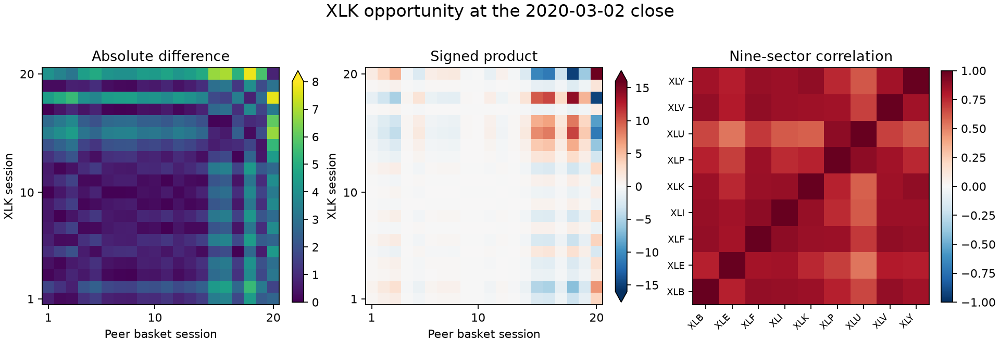

# Cross-sector return maps for ETF trade selection

Can the pattern of a sector ETF's recent returns relative to other sectors improve the selection of profitable momentum trades? This revision preserves the nine-sector universe, next-open execution, CUSUM events, triple-barrier profitability labels, and 5 bps per side primary cost from Stage 1.

## 1. Prepare and inspect the inputs

At each signal close, use the last 20 sessions, including the signal date. Pair the target ETF's daily simple returns with an equal-weight portfolio of the other eight ETFs rebalanced daily. Both inputs therefore retain their identities across all nine target ETFs. Fit per-ETF means and standard deviations for the target and peer series on historical reference sessions through the latest retained training signal in each fold. Clip standardized values at ±8 before forming the maps.

The two numeric channels are the absolute difference and product for each pair of days. Both axes index chronological days. The diagonal compares the same trading session, and off-diagonals compare different sessions within the lookback. Positive products indicate standardized returns on the same side of their training means. The two maps discard the joint sign of both sequences, so a separate temporal model on the signed returns is an important comparison. Feed the numbers themselves to the CNN. Plot the maps with consistent axes and color scales for inspection.

The companion nine-sector heatmap shows 60-session Pearson correlations in fixed ticker order. Sector identity has no natural spatial ordering, so the 9 × 9 heatmap serves as a descriptive visualization. The largest eigenvalue divided by nine is a scalar measure of market collectivity for the tabular benchmark.

## 2. Compare models on development folds

Use 2005–2014 for the first fit and the existing seven expanding annual validation folds for 2015–2021. Apply the Stage 1 eleven-session boundary gap and exit-date purge. Each validation trade must resolve within its annual fold. Compare the following on identical events:

| Model | Inputs |
| --- | --- |
| Logistic regression | Stage 1 indicators and fixed-window cross-sector summaries |
| XGBoost | Stage 1 indicators and the same fixed-window cross-sector summaries |
| 1D CNN | The two standardized 20-session return sequences, plus the shared tabular inputs |
| 2D CNN | The two 20 × 20 maps, plus the shared tabular inputs |

The shared tabular inputs include ETF identity, existing technical indicators, lagged VIX, SPY trend and drawdown, and cross-sector summaries computed from the same lookback. Keep the CNNs small and use the same optimizer, budget and seeds. Compare pooled and yearly log loss, Brier score, average precision and ROC AUC. Use a common 30% candidate-coverage target to choose each fixed probability threshold from pooled development predictions. Compare portfolio returns after fees and report both accepted opportunities and executed trades. The VIX-only strategy selects its cutoff on development returns. Freeze these settings before evaluating any holdout outcomes.

## 3. Evaluate the frozen strategy

Fit with the purged pre-2022 data and score 2022–2024 once. Use the same simulator for all strategies. Report coverage, mean capital exposure, turnover, drawdown, net Sharpe, and trade profitability. Compare against unfiltered momentum, the VIX rule, and random abstention at matched candidate coverage. A second random control can use the fixed development acceptance rate. Use paired calendar-block bootstrap intervals to show uncertainty in differences. Repeat the frozen decision rules under the original fee grid, and use weekly Fama–French factors to describe return exposures when the course dataset is available.

The main predictive comparison is 2D CNN versus 1D CNN. The main economic comparison is 2D CNN versus the 1D CNN and random abstention at similar participation. Outcomes are dependent across nearby dates and sectors, so event counts cannot be treated as independent trials.

## Research references

- Jiang, Kelly and Xiu, [*(Re-)Imag(in)ing Price Trends*](https://doi.org/10.1111/jofi.13268).
- Wang and Oates, [*Imaging Time-Series to Improve Classification and Imputation*](https://ijcai.org/proceedings/2015/553).
- Marwan and Kurths, [*Nonlinear Analysis of Bivariate Data with Cross Recurrence Plots*](https://doi.org/10.1016/S0375-9601(02)01170-2).
- [*On Financial Market Correlation Structures and Diversification Benefits Across and Within Equity Sectors*](https://arxiv.org/abs/2202.10623).
