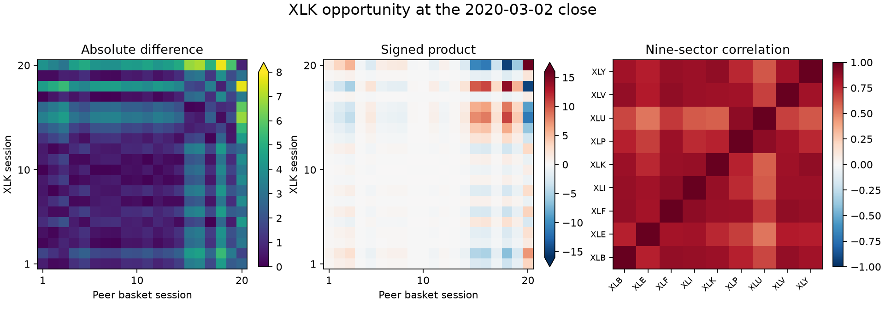

# Cross-Sector Return Maps for ETF Trade Selection

**Math 628 research report** · 2026-11-15

The 2D CNN scored slightly better than the 1D CNN on both holdout log loss (0.7119 versus 0.7135) and net Sharpe (−0.414 versus −0.507). XGBoost had the lowest log loss among the four fitted models at 0.7037. A constant probability estimated from the training labels achieved 0.6983. The 2D CNN's annualized net return was −2.21%. Its Sharpe advantage over random selection at the same candidate coverage was 0.079, with a 95% interval from −0.541 to 0.688.

## Method

Nine sector ETFs generated momentum opportunities under the Stage 1 trading rules. At each signal close, the recent target and peer-basket returns were supplied directly to a 1D CNN or transformed into absolute-difference and signed-product maps for a 2D CNN. Both CNNs and the two tabular baselines share the market, instrument and return-summary features. Each annual fit uses information available in its training set.

See the [research plan](../docs/cnn_research_plan.md) for representation, chronology and references. The fixed-development 30% target defines each probability cutoff. A VIX cutoff of **35** was chosen on development net Sharpe. All scores use the same candidate set within each period. Three fixed seeds are averaged for each CNN.

## Development, 2015–2021

The best pooled development log loss came from **xgboost**. Development thresholds were selected using these out-of-fold predictions. Development performance therefore describes the selection sample.

| period | model | events | log_loss | brier | average_precision | roc_auc |
| --- | --- | --- | --- | --- | --- | --- |
| pooled | logistic | 1971 | 0.7020 | 0.2540 | 0.5713 | 0.4998 |
| pooled | xgboost | 1971 | 0.6965 | 0.2514 | 0.5816 | 0.5236 |
| pooled | cnn_1d | 1971 | 0.7000 | 0.2531 | 0.5658 | 0.5029 |
| pooled | cnn_2d | 1971 | 0.6985 | 0.2522 | 0.5871 | 0.5172 |

| strategy | candidate_coverage | annualized_return | sharpe | max_drawdown | mean_exposure | trades |
| --- | --- | --- | --- | --- | --- | --- |
| logistic | 0.3004 | 0.0141 | 0.3293 | -0.0963 | 0.1782 | 352 |
| xgboost | 0.3004 | 0.0273 | 0.5542 | -0.0928 | 0.1872 | 371 |
| cnn_1d | 0.3004 | 0.0212 | 0.4707 | -0.0476 | 0.1768 | 366 |
| cnn_2d | 0.3004 | 0.0249 | 0.5195 | -0.0721 | 0.1816 | 366 |
| unfiltered | 1.0000 | 0.0473 | 0.6804 | -0.0771 | 0.4596 | 882 |
| vix_filter | 0.9888 | 0.0519 | 0.7599 | -0.0762 | 0.4560 | 874 |

## Frozen holdout, 2022–2024

The final estimators trained on **5,035** eligible pre-2022 events. Each model's threshold is fixed, so realized test-period acceptance can differ across models.

| period | model | events | log_loss | brier | average_precision | roc_auc |
| --- | --- | --- | --- | --- | --- | --- |
| pooled | logistic | 786 | 0.7064 | 0.2565 | 0.4717 | 0.4563 |
| pooled | xgboost | 786 | 0.7037 | 0.2552 | 0.4973 | 0.4786 |
| pooled | cnn_1d | 786 | 0.7135 | 0.2598 | 0.4851 | 0.4632 |
| pooled | cnn_2d | 786 | 0.7119 | 0.2590 | 0.4927 | 0.4786 |

| strategy | candidate_coverage | annualized_return | sharpe | max_drawdown | mean_exposure | trades |
| --- | --- | --- | --- | --- | --- | --- |
| logistic | 0.4427 | -0.0264 | -0.4858 | -0.1312 | 0.2341 | 193 |
| xgboost | 0.4517 | -0.0363 | -0.6305 | -0.1702 | 0.2333 | 191 |
| cnn_1d | 0.4835 | -0.0285 | -0.5073 | -0.1537 | 0.2620 | 210 |
| cnn_2d | 0.4109 | -0.0221 | -0.4142 | -0.1279 | 0.2176 | 179 |
| unfiltered | 1.0000 | -0.0407 | -0.5698 | -0.1746 | 0.4248 | 343 |
| vix_filter | 0.9987 | -0.0407 | -0.5698 | -0.1746 | 0.4248 | 343 |
| spy_buy_hold | N/A | 0.0874 | 0.5664 | -0.2450 | 1.0000 | 0 |
| sector_buy_hold | N/A | 0.0719 | 0.5346 | -0.1650 | 1.0000 | 0 |

| strategy | candidate_coverage | annualized_return | sharpe | max_drawdown | mean_exposure | trades |
| --- | --- | --- | --- | --- | --- | --- |
| random_development_rate | 0.3027 | -0.0180 | -0.4284 | -0.1101 | 0.2072 | 170.6406 |
| random_matched | 0.4109 | -0.0245 | -0.4936 | -0.1315 | 0.2581 | 211.8750 |

The random controls show means across repeated allocations. The matched control accepts exactly the 2D CNN's number of opportunities and is a retrospective benchmark. The development-rate control uses the 2D CNN's frozen development acceptance probability. Sleeve conflicts can produce different realized trade counts and exposure even when acceptance counts match. The 2D CNN's mean capital exposure was 21.8%, compared with 25.8% for the matched controls.

### Constant probability reference

As an additional forecasting check, each development fold was scored with a constant probability equal to the mean binary label in that fold's purged training set. Its pooled log loss was **0.6838**. The mean label in the final purged training set was **0.5559**, yielding holdout log loss of **0.6983**. Both reference scores were lower than the corresponding scores of all four fitted models. This comparison assesses probability forecasts independently of threshold choice. The underlying historical label indices are generated by the Stage 1 split command.

## Paired Sharpe uncertainty

The comparison is 2D CNN minus the specified benchmark. Each draw resamples aligned calendar blocks of 20 sessions. The random comparison takes the mean of the random portfolios' Sharpes on each resample. The intervals condition on the fitted models and random allocations.

| comparison | cnn_2d_sharpe_difference | ci_2.5% | ci_97.5% |
| --- | --- | --- | --- |
| cnn_1d | 0.0931 | -0.4822 | 0.6916 |
| xgboost | 0.2163 | -0.2733 | 0.7092 |
| unfiltered | 0.1556 | -0.5403 | 0.8056 |
| vix_filter | 0.1556 | -0.5403 | 0.8056 |
| random_matched | 0.0794 | -0.5411 | 0.6882 |

## Fee sensitivity

The following table uses the same trades and thresholds at each fee level.

| strategy | cost_bps_per_side | annualized_return | sharpe |
| --- | --- | --- | --- |
| unfiltered | 0 | -0.0283 | -0.3843 |
| xgboost | 0 | -0.0295 | -0.5056 |
| cnn_1d | 0 | -0.0209 | -0.3621 |
| cnn_2d | 0 | -0.0156 | -0.2834 |
| unfiltered | 5 | -0.0407 | -0.5698 |
| xgboost | 5 | -0.0363 | -0.6305 |
| cnn_1d | 5 | -0.0285 | -0.5073 |
| cnn_2d | 5 | -0.0221 | -0.4142 |
| unfiltered | 10 | -0.0528 | -0.7549 |
| xgboost | 10 | -0.0430 | -0.7550 |
| cnn_1d | 10 | -0.0361 | -0.6525 |
| cnn_2d | 10 | -0.0285 | -0.5447 |
| unfiltered | 20 | -0.0767 | -1.1232 |
| xgboost | 20 | -0.0564 | -1.0027 |
| cnn_1d | 20 | -0.0511 | -0.9422 |
| cnn_2d | 20 | -0.0413 | -0.8044 |

## Factor attribution and limitations

| strategy | weeks | term | estimate | hac_se |
| --- | --- | --- | --- | --- |
| unfiltered | 155 | const | -0.0018 | 0.0005 |
| unfiltered | 155 | Mkt-RF | 0.2731 | 0.0525 |
| unfiltered | 155 | SMB | 0.0375 | 0.0303 |
| unfiltered | 155 | HML | 0.1217 | 0.0358 |
| cnn_1d | 155 | const | -0.0015 | 0.0004 |
| cnn_1d | 155 | Mkt-RF | 0.2053 | 0.0394 |
| cnn_1d | 155 | SMB | 0.0416 | 0.0287 |
| cnn_1d | 155 | HML | 0.0409 | 0.0245 |
| cnn_2d | 155 | const | -0.0014 | 0.0004 |
| cnn_2d | 155 | Mkt-RF | 0.1821 | 0.0341 |
| cnn_2d | 155 | SMB | 0.0545 | 0.0273 |
| cnn_2d | 155 | HML | 0.0594 | 0.0232 |

Factor estimates are weekly and use heteroskedasticity- and autocorrelation-consistent standard errors with four lags. Nearby signal windows overlap and same-day ETFs share market movements. The holdout spans one three-year interval. The return maps remove the simultaneous sign of both original sequences. This comparison consequently tests the entire map representation plus its CNN, including the information discarded by the encoding.

The [frozen configuration](cnn/frozen_spec.json), [yearly metrics](cnn/development_forecast_metrics.csv), [holdout calibration](cnn/test_calibration.csv), and remaining summary tables in [reports/cnn](cnn/) accompany this report. Reproduction commands are in the [README](../README.md).
