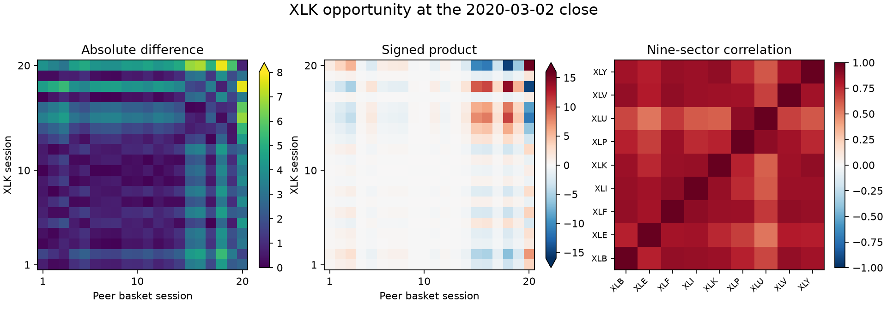

# Learning When to Stay Out
## Cross-sector return maps for ETF trade selection

*Math 628 · Machine Learning in Finance · Final research report*

### Abstract

We test whether two-dimensional return maps improve selection among U.S. sector ETF momentum trades. Each map represents the latest 20 sessions of a target ETF and an equal-weight basket of its eight peers. We compare a 2D CNN with a temporal 1D CNN, logistic regression, XGBoost and a constant probability estimated from training labels. On 786 holdout opportunities in 2022–2024, the 2D CNN improves log loss over the 1D CNN by 0.0016, but its paired 95% interval spans zero. The constant reference has the lowest log loss. The 2D strategy returns −2.21% annualized after fees. Its Sharpe advantage over the 1D CNN nearly vanishes in a retrospective comparison at equal candidate coverage. The experiment therefore offers limited evidence that the map improves either probability forecasts or trade selection.

### 1. Research question and sample

A long momentum rule generates possible trades. A second model estimates whether each one is likely to earn a positive return after costs. We ask whether the relative behavior of a target sector and its peers adds value when it is encoded as a two-dimensional map. Prior work has applied CNNs to visualized price histories and has encoded relationships between observations in time series as image-like matrices [1–3]. We focus on the incremental value of one representation for this particular trading decision.

The universe contains nine U.S. sector ETFs: XLB, XLE, XLF, XLI, XLK, XLP, XLU, XLV and XLY. We use daily adjusted Yahoo Finance prices and volume, SPY as the market reference, and the FRED VIX closing series lagged by one trading session. The frozen sample covers 2005–2024 with 2004 used for warm-up. The development data contain 5,038 labeled trades. Of those, 1,971 resolve inside the seven annual validation folds for 2015–2021. The final fit uses 5,035 eligible pre-2022 events after purging. The untouched portion at model selection contains 786 opportunities in 2022–2024. The weekly Fama–French regression uses the course's December 2024 data vintage [4–6].

### 2. Signals, features and validation

The 20-day moving average must exceed the 50-day average and a symmetric cumulative-sum filter must trigger to create a long candidate. The filter threshold is twice the lagged 30-span exponentially weighted volatility estimate. A trade enters at the next open. A symmetric return barrier at daily volatility multiplied by the square root of ten is checked at closes, with exit at the next open after a hit. If there is no hit, the trade exits at the open ten sessions after entry. The label is one when the net trade return is positive. We use 5 basis points per side and vendor-adjusted price units throughout.

At the signal close, we pair the target's last 20 daily simple returns with those of the other eight sectors, equally weighted each day. We fit the mean and standard deviation of each series using the historical sessions available to the training fold and clip standardized values at ±8. For target day i and peer day j with standardized returns x(i) and y(j), the two map channels are |x(i) − y(j)| and x(i)y(j). The diagonal pairs the same trading day. The second channel identifies whether the standardized returns are on the same side of their respective means. Simultaneously reversing both series leaves both maps unchanged, so the 2D encoding loses that aspect of direction.

The 1D CNN consumes both signed sequences. The 2D CNN consumes both maps. Both receive identical tabular inputs, including technical features, ETF identity, lagged VIX, SPY context and cross-sector summaries. The tabular logistic regression and XGBoost use these same contextual variables. The networks have two convolution layers and average the probabilities of three fixed-seed fits. We use expanding annual folds and an 11-session boundary gap, purge training labels that resolve beyond the boundary and require validation labels to resolve within their year. Thresholds target 30% candidate coverage on pooled validation forecasts. This gives the four models the same development candidate count while allowing coverage to vary under fixed thresholds in the holdout.

### 3. Forecast evidence

| Probability forecast | 2015–2021 log loss | 2022–2024 log loss | Holdout ROC AUC |
| --- | ---: | ---: | ---: |
| Training prevalence | 0.6838 | 0.6983 | 0.5000 |
| Logistic regression | 0.7020 | 0.7064 | 0.4563 |
| XGBoost | 0.6965 | 0.7037 | 0.4786 |
| 1D CNN | 0.7000 | 0.7135 | 0.4632 |
| 2D CNN | 0.6985 | 0.7119 | 0.4786 |

Lower log loss is better. The reference forecasts the mean label from the relevant purged training sample. The positive label rate declined from 57.3% on the validation candidates to 50.5% in the holdout. The 2D-minus-1D loss difference is −0.0016, with a retrospective 95% paired calendar-block interval of [−0.0120, 0.0097]. The corresponding 2D-minus-training-reference difference is +0.0136, with an interval of [−0.0022, 0.0329]. We resample aligned blocks of 20 trading sessions so same-date events are resampled together. The intervals condition on the fitted models and the observed market histories.

### 4. Portfolio results and matched decisions

Each event strategy starts with nine equal capital sleeves. A sleeve can hold one long position and earns zero on idle cash. Selected opportunities can fail to execute if their sleeves are occupied. We use the same backtest and costs for every decision rule.

| Holdout rule at 5 bps per side | Candidate coverage | Trades | Mean exposure | Annualized net return | Net Sharpe |
| --- | ---: | ---: | ---: | ---: | ---: |
| Unfiltered momentum | 100.0% | 343 | 42.5% | −4.07% | −0.570 |
| VIX ≤ 35 | 99.9% | 343 | 42.5% | −4.07% | −0.570 |
| Logistic regression | 44.3% | 193 | 23.4% | −2.64% | −0.486 |
| XGBoost | 45.2% | 191 | 23.3% | −3.63% | −0.631 |
| 1D CNN | 48.3% | 210 | 26.2% | −2.85% | −0.507 |
| 2D CNN | 41.1% | 179 | 21.8% | −2.21% | −0.414 |
| Matched random selection, mean of 64 runs | 41.1% | 211.9 | 25.8% | −2.45% | −0.494 |

The paired 2D-minus-1D Sharpe difference at frozen thresholds is +0.093 with a 95% interval of [−0.482, 0.692]. The 2D-minus-matched-random difference is +0.079 with an interval of [−0.541, 0.688]. To isolate candidate count more directly, we also rank holdout scores and keep exactly 323 candidates per model. The 1D and 2D Sharpes become −0.410 and −0.414, respectively. This ranking is a retrospective diagnostic because it uses the full holdout score distribution to set the count. Exposure still differs across rules. The result suggests the frozen-threshold advantage is sensitive to portfolio participation.

At zero fees the 2D strategy still returns −1.56% annualized. Its return falls to −4.13% at 20 bps per side with the same trades. The weekly three-factor regression uses 155 matched weeks. The 2D market beta is 0.182, compared with 0.273 for unfiltered momentum. Its weekly intercept is −0.14% with a HAC standard error of about 0.04 percentage points. These regressions describe exposures, with no causal interpretation.

### 5. Interpretation and limits

The 2D encoding provides an inspectable description of how recent sector returns relate to peers. Its added forecasting value is weak in this sample. The 30% development coverage target produced different holdout coverage and capital exposure, and matching the opportunity count removed the observed 2D-versus-1D Sharpe advantage. The holdout covers one three-year period on a fixed universe. Nearby windows overlap and sectors share market movements. The results depend on daily closes, next-open fills and a flat transaction-cost model. Sector classifications and the ETF investment exposures changed over time [6].

The revised project focuses the original proposal on testing the return representation. Its four learned comparators, participation controls and uncertainty checks answer that question. The original random-forest benchmark, technical-to-market feature ablation and interest-on-cash extension are outside this revised comparison. A future test could evaluate new periods with a sign-preserving map and an exposure-matched benchmark.

### Sources and reproducibility

1. Jiang, J., Kelly, B., and Xiu, D. (2023). [(Re-)Imag(in)ing Price Trends](https://doi.org/10.1111/jofi.13268).
2. Wang, Z., and Oates, T. (2015). [Imaging Time-Series to Improve Classification and Imputation](https://ijcai.org/proceedings/2015/553).
3. Marwan, N., and Kurths, J. (2002). [Nonlinear analysis of bivariate data with cross recurrence plots](https://doi.org/10.1016/S0375-9601(02)01170-2).
4. [Yahoo Finance data access through yfinance](https://ranaroussi.github.io/yfinance/reference/yfinance.ticker_tickers.html) and [FRED VIXCLS](https://fred.stlouisfed.org/series/VIXCLS).
5. [Kenneth R. French Data Library](https://mba.tuck.dartmouth.edu/pages/faculty/ken.french/data_library.html).
6. [Sector history and primary sources](../docs/sector_history.md).

The [project repository](https://github.com/ljunyan00/math-628-sector-meta-labeling) contains the acquisition and execution commands, the [frozen specification](cnn/frozen_spec.json), and the [supplemental diagnostic tables](final/). Running `PYTHONPATH=src .venv/bin/python -m sector_meta.final_review` reconstructs the input labels, checks the saved probabilities and portfolios, and generates the supplemental tables. The raw vendor files are acquired separately.
