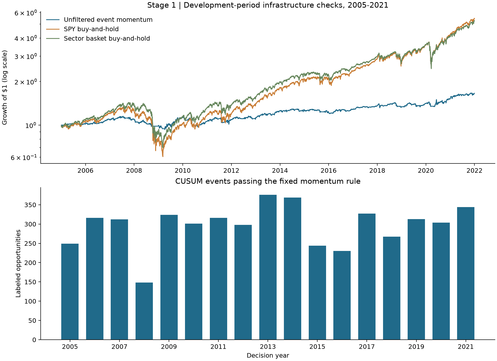

# Stage 1 Progress Report

**Project:** Learning When to Stay Out: Regime-Aware Meta-Labeling for U.S. Sector ETF Momentum<br>
**Course:** Math 628 - Machine Learning in Finance<br>
**Report date:** 2026-11-03 (America/Detroit)<br>
**Status:** Stage 1 implemented and executed on downloaded historical data. Models and final-test evaluation remain pending.

## 1. Three-stage delivery plan

| Stage | Scope | Status |
| --- | --- | --- |
| 1 | Data acquisition and audit, causal features, CUSUM/triple-barrier labels, shared execution engine, chronological splits, development baselines | Implemented and run |
| 2 | Logistic Regression, Random Forest, XGBoost; three nested feature sets; fold-local preprocessing; development selection of settings, probability and VIX thresholds | Pending |
| 3 | Frozen 2022-2024 evaluation; random abstention and participation controls; bootstrap uncertainty; factor attribution; final results and report | Pending |

The proposal's H1-H3 concern incremental prediction and economic selection. Stage 1 establishes infrastructure and descriptive baselines; it does not test those hypotheses or demonstrate profitable model selection.

## 2. Data acquisition and audit

Nine sector ETFs and SPY were acquired from Yahoo Finance through yfinance. FRED VIXCLS was acquired separately. A 2004 warm-up precedes the 2005-2024 research sample. Download end dates are exclusive. Each raw file has a SHA-256 checksum, source and acquisition timestamp in `data/raw/manifest.json`; package versions are saved with the run.

| ticker | first_date | last_date | sessions | missing_spy_sessions | extra_sessions | invalid_price_volume_rows | invalid_ohlc_rows | dividend_rows | split_rows |
| --- | --- | --- | --- | --- | --- | --- | --- | --- | --- |
| XLB | 2004-01-02 | 2024-12-31 | 5285 | 0 | 0 | 0 | 0 | 84 | 0 |
| XLE | 2004-01-02 | 2024-12-31 | 5285 | 0 | 0 | 0 | 0 | 85 | 0 |
| XLF | 2004-01-02 | 2024-12-31 | 5285 | 0 | 0 | 0 | 0 | 84 | 1 |
| XLI | 2004-01-02 | 2024-12-31 | 5285 | 0 | 0 | 0 | 0 | 84 | 0 |
| XLK | 2004-01-02 | 2024-12-31 | 5285 | 0 | 0 | 0 | 0 | 75 | 0 |
| XLP | 2004-01-02 | 2024-12-31 | 5285 | 0 | 0 | 0 | 0 | 84 | 0 |
| XLU | 2004-01-02 | 2024-12-31 | 5285 | 0 | 0 | 0 | 0 | 84 | 0 |
| XLV | 2004-01-02 | 2024-12-31 | 5285 | 0 | 0 | 0 | 0 | 85 | 0 |
| XLY | 2004-01-02 | 2024-12-31 | 5285 | 0 | 0 | 0 | 0 | 84 | 0 |
| SPY | 2004-01-02 | 2024-12-31 | 5285 | 0 | 0 | 0 | 0 | 85 | 0 |

The audit checks unique sorted dates, coverage relative to the downloaded SPY calendar, finite positive prices and volume, OHLC ordering, requested endpoints and cache checksums. It does not independently verify every exchange session against a second vendor. No missing ETF observations are forward-filled. Historical constituent portfolios are not reconstructed. [Sector history notes](../docs/sector_history.md) document the 2016 real estate separation, 2018 communication services changes and 2023 reclassifications with primary sources; a complete constituent-change history is outside this implementation.

The fixed local factor vintage contains 5,139 weekly rows, ending 2024-12-27. Exact observed endpoint matching produces 886 complete development weeks. The first partial week is excluded. Percentages were divided by 100; no factor regression has been fitted.

## 3. Features and timing

The table contains 45,297 ETF-date rows over 2005-2024. The development event table has 0 missing values across the explicit full-model predictor list. No imputer, scaler, encoder or regime threshold has been fitted.

| Group | Implemented predictors |
| --- | --- |
| Technical | 1/5/20-session adjusted returns, MA20/MA50 minus one, normalized RSI, EMA12-minus-EMA26 divided by price, 30-span EWM log-return volatility, volume divided by its 20-session mean |
| Market | One-session-lagged VIX level/change, SPY 20-session return and rolling 60-session drawdown |
| Cross-sector | Mean of 36 pairwise 60-session return correlations, five-session mean daily cross-sector dispersion, ETF 20-session return minus daily-rebalanced equal-weight basket return |
| Interaction and identity | Correlation times SPY drawdown; ETF ticker |

VIX is forward-filled from historical observed values before shifting by one SPY trading session; its source date is retained. Values more than seven calendar days old are invalidated. Maximum development source age is 5 calendar days. All rolling features use past or current-close information only. The full-feature interaction is available for Logistic Regression in Stage 2. `feature_dictionary.json` supplies a strict predictor whitelist: realized returns, exit information and labels must never enter model inputs.

## 4. Opportunity and execution specification

An opportunity requires adjusted MA20 > MA50 and a symmetric CUSUM trigger. CUSUM uses daily log returns and twice the previous session's 30-span EWM volatility. Warm-up is carried through sampling before restricting signal dates to the research period.

Decisions occur after close t; entry is at open t+1. The symmetric arithmetic-return barrier width is volatility at t times sqrt(10). Closes are monitored from entry through the ninth session after entry; a hit executes at the next open. The scheduled time exit is at the open ten sessions after entry. A final monitored-close hit coinciding with that scheduled exit keeps its profit/loss category. Gaps can make a profit-barrier trade lose money, so the binary label always uses realized return after costs.

For entry price P0, exit price P1 and per-side cost c, net return is P1*(1-c)/(P0*(1+c))-1. Positive net return gives label 1; all other complete exits give label 0. The primary cost is 5 bps per side. Execution uses open and close prices multiplied by the same Adj Close/Close adjustment factor. This is a vendor-adjusted total-return-unit approximation with implicit distribution reinvestment; dividends are not added again. It is not a literal share-and-cash dividend ledger, and adjustment revisions remain a data-vintage limitation.

Portfolio execution uses nine initially equal sleeves, one position per ETF, no leverage, no cross-sleeve rebalancing and zero cash yield. Signals while a sleeve is occupied are skipped. Equity is marked at every close, including entry and exit costs. Hypothetical event labels may overlap; the executable portfolio does not allow overlapping positions within a sleeve. Every executed trade was reconciled against the shared label engine to 1e-12 absolute tolerance.

## 5. Development labels and chronological splits

There are 5,038 complete development opportunities and 2,160 executed unfiltered trades. Another 8 opportunities have no observable complete development exit and are excluded. Data are cut at 2022 before constructing these labels, so a late-2021 event cannot use a 2022 exit.

| ticker | events | positive_rate | mean_net_return | mean_holding_sessions |
| --- | --- | --- | --- | --- |
| XLB | 531 | 0.5650 | 0.0024 | 8.3785 |
| XLE | 500 | 0.5320 | 0.0012 | 8.1640 |
| XLF | 502 | 0.5538 | 0.0033 | 8.2430 |
| XLI | 534 | 0.5599 | 0.0021 | 8.1685 |
| XLK | 602 | 0.5864 | 0.0032 | 8.0748 |
| XLP | 594 | 0.5640 | 0.0007 | 8.3754 |
| XLU | 592 | 0.5220 | 0.0001 | 8.0084 |
| XLV | 596 | 0.5621 | 0.0011 | 8.1779 |
| XLY | 587 | 0.5571 | 0.0021 | 7.9506 |

| barrier | events | positive_rate |
| --- | --- | --- |
| loss | 1113 | 0.0018 |
| profit | 1250 | 1.0000 |
| time | 2675 | 0.5794 |

| fold | train_events | validation_events | train_signal_before | train_exit_before | validation_exit_before |
| --- | --- | --- | --- | --- | --- |
| 2015 | 2983 | 231 | 2014-12-16 | 2015-01-01 | 2016-01-01 |
| 2016 | 3238 | 222 | 2015-12-16 | 2016-01-01 | 2017-01-01 |
| 2017 | 3475 | 314 | 2016-12-15 | 2017-01-01 | 2018-01-01 |
| 2018 | 3796 | 265 | 2017-12-14 | 2018-01-01 | 2019-01-01 |
| 2019 | 4071 | 303 | 2018-12-14 | 2019-01-01 | 2020-01-01 |
| 2020 | 4378 | 292 | 2019-12-16 | 2020-01-01 | 2021-01-01 |
| 2021 | 4682 | 344 | 2020-12-16 | 2021-01-01 | 2022-01-01 |

Each training fold excludes signal dates in the final eleven SPY sessions before the annual boundary and requires exit dates strictly before refitting. Validation events must resolve before the next annual boundary, a conservative convention that prevents 2021 validation labels from touching 2022. Split indices refer to row positions in `development_events.csv` and `development_samples.csv`.

Final-train indices are prepared for the 2022 boundary. **No 2022-2024 profitability labels, model scores or portfolio results have been generated.** Acquisition and coverage auditing of those dates are separate from outcome evaluation. The local files are not a cryptographically sealed holdout; the workflow enforces this separation procedurally.

## 6. Development baseline diagnostics

These are descriptive 2005-2021 results on the development sample. They are not final-test evidence. All rows use 5 bps per side. Buy-and-hold enters at the first observed open and liquidates at the final close; sector buy-and-hold starts equally allocated and does not rebalance. Event momentum is flat at the endpoint because incomplete paths are excluded.

| strategy | annualized_return | sharpe | max_drawdown | mean_exposure | trades |
| --- | --- | --- | --- | --- | --- |
| Unfiltered event momentum | 0.0303 | 0.4175 | -0.1908 | 0.4638 | 2160 |
| SPY buy-and-hold | 0.1049 | 0.6137 | -0.5519 | 1.0000 | 0 |
| Sector basket buy-and-hold | 0.1027 | 0.6220 | -0.5140 | 1.0000 | 0 |

Returns, drawdowns and exposures are decimals. Sharpe uses sqrt(252) times mean daily return divided by its sample standard deviation, with zero risk-free rate. Annualized return uses 252 trading sessions. Max drawdown includes initial capital in the high-water mark. Exposure is the portfolio fraction invested; a lower drawdown by itself does not demonstrate better trade selection. Buy-and-hold has no event trade ledger, so its event-trade count is shown as zero.



The cost sensitivity below preserves event dates and exit paths, recomputes fee-dependent labels and reruns sleeve accounting. No filter or model is reselected.

| cost_bps_per_side | event_positive_rate | annualized_return | sharpe | max_drawdown | trades |
| --- | --- | --- | --- | --- | --- |
| 0 | 0.5687 | 0.0449 | 0.5966 | -0.1787 | 2160 |
| 5 | 0.5562 | 0.0303 | 0.4175 | -0.1908 | 2160 |
| 10 | 0.5451 | 0.0159 | 0.2391 | -0.2027 | 2160 |
| 20 | 0.5220 | -0.0122 | -0.1154 | -0.3151 | 2160 |

## 7. Verification and reproducibility

The automated test suite covers next-open execution, adverse gap fills, time-exit profitability, incomplete paths, CUSUM timing, VIX lag, future-data perturbation invariance, overlap skipping, cost reconciliation, chronology and factor percentage conversion. A saved [test result](artifacts/test_results.txt) accompanies the report. Run the test command below to verify the current checkout.

```bash
python3 -m venv .venv
.venv/bin/python -m pip install -r requirements-lock.txt
PYTHONPATH=src .venv/bin/python -m sector_meta.cli download --factors /path/to/F-F_Research_Data_Factors_weekly.csv
PYTHONPATH=src .venv/bin/python -m sector_meta.cli stage1
.venv/bin/python -m pytest -q
```

After acquisition, Stage 1 runs offline from checksum-verified cached CSV files. The configuration snapshot is generated in `output/stage1/frozen_stage1_config.json`; input checksums and run metadata are included in the [published run summary](artifacts/run_summary.json). Configuration SHA-256: `78cfb73c933ec041bf0e2dd03ad3dc22f1f27de270aa5784536fab9376e0b710`. Reusing a modified cache fails verification. Re-downloading may change vendor revisions, so preserve the original manifest and cache for exact replication. Raw data remain local and are ignored by Git. The repository includes the report figure and small derived summary tables under `reports/`, so these remain viewable without downloading market data.

## 8. Remaining work and Stage 2 handoff

Stage 2 should fit fold-local preprocessing and compare Logistic Regression, Random Forest and XGBoost on exactly the same opportunities. The three feature lists are declared in `features.py`; the full Logistic Regression specification includes the predeclared correlation-by-drawdown interaction. Select hyperparameters and a probability cutoff from the declared grid using development performance, subject to at least 20% candidate coverage. Select the simple VIX benchmark cutoff using development folds. Save fold-level forecasts, forecast metrics, calibration and threshold sensitivity before freezing the final specification.

Stage 3 should generate test labels only after that freeze, evaluate the untouched 2022-2024 period without refitting, add development-rate and retrospective participation-matched random controls, paired calendar moving-block bootstrap intervals, risk-free cash sensitivity and weekly factor regression with autocorrelation-robust uncertainty. It should also complete permutation importance, conditional stress plots and final interpretation of the documented sector changes and limitations.

No classifier, threshold optimization, random abstention experiment, bootstrap interval, risk-free cash sensitivity or factor regression is claimed complete in Stage 1. Stage 1 is ready to supply their data and shared execution rules.

## Sources

- Research specification: the user-provided `Project_Proposal.pdf`, dated October 9, 2026.
- [yfinance download API](https://ranaroussi.github.io/yfinance/reference/api/yfinance.download.html) and [historical price API](https://ranaroussi.github.io/yfinance/reference/api/yfinance.Ticker.history.html).
- [FRED VIXCLS](https://fred.stlouisfed.org/series/VIXCLS).
- Fixed course-local Fama-French weekly CSV, 202412 CRSP vintage; exact file provenance is in the acquisition manifest.
