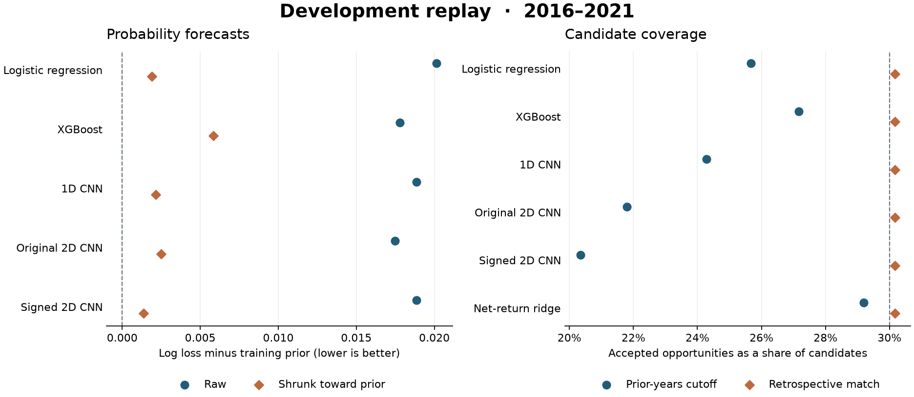

# Technical Review and Development Revision

## Findings from the original run

The original experiment is reproducible, and its final review verified label timing, probability files and the trading ledger. Its main weakness is evidence of incremental value. The 2022–2024 training-prevalence reference achieved log loss of 0.6983. Every fitted classifier scored worse. The 2D CNN had a small Sharpe advantage over the 1D CNN at frozen thresholds, but the 2D model accepted 41.1% of candidates and the 1D model accepted 48.3%. At exactly 323 accepted candidates each, the 1D and 2D Sharpes were −0.410 and −0.414. One calendar holdout with overlapping windows limits the precision of those estimates. The [original final report](Final_Report.md) retains the frozen results.

| Issue | Consequence | Implemented revision |
| --- | --- | --- |
| The original map uses absolute difference and product. Both are invariant when both input sequences reverse sign. | The 2D encoder cannot distinguish joint upside from joint downside in the map channels. The wider model can still observe directions through its signed tabular features. | Keep the CNN, seeds, training budget and context fixed. Replace both map channels with signed sum and signed difference, each divided by the square root of two. Both standardized input series can be recovered algebraically. |
| The label discards gain and loss magnitudes. | A higher estimated chance of profit can still imply a lower expected return. | Add a ridge model that forecasts the net trade return directly. Compare it with the training mean on squared-error loss and with other scoring rules in the same fee-adjusted simulator. |
| The training-prevalence forecast beat the fitted classifiers in the original holdout. | The learned probability can make a weaker forecast than a much simpler model. | Compare each raw probability against its training prior on every development fold. Fit a convex blend from earlier out-of-fold predictions on a fixed weight grid that includes zero. This allows an automatic fallback when prior years favor the simple model. |
| The original development threshold and its reported development performance used the same pooled predictions. | Development performance partly describes threshold selection. The original frozen holdout was still separate from threshold selection. | For each new replay year, set the cutoff from earlier out-of-fold scores only. Report actual coverage, trades and exposure. Also show a separate within-year retrospective coverage match. |
| The annual development universe conditioned on the actual exit occurring within the year. | Near year-end, some signals could retrospectively qualify because a price barrier happened to hit early. | Close the candidate window based on scheduled sessions and the maximum trade horizon. All admitted signals could reach their scheduled time exit before the year boundary. |

Model coefficients, preprocessing and each training prior use the original expanding annual splits. The revision reuses verified baseline forecasts from `cnn-develop`. It uses 2015 for the first policy fit and scores decisions in 2016–2021. When choosing a probability blend for a year, earlier predictions and their completed labels are used. The target for decision cutoffs is 30% candidate coverage. The historical rule applies score cutoffs to the new year's candidates and allows realized coverage to move. Retrospective matching ranks all scores for a year and gives each model the same approximate 30% quota, rounded up to a whole candidate. Portfolio outcomes use the raw score ordering, including when a probability blend falls back fully to the prior.

All new results use development years. The 2022–2024 holdout was used to inform this review and is already observed. A fresh comparison would require a new evaluation interval fixed before examining its outcomes. The signed map ablation changes both map channels at once, so any observed difference cannot be attributed solely to joint sign. A future ablation could test signed difference alone alongside product and could separately test a tighter model budget. For methodology, see [Cawley and Talbot on model selection bias](https://www.jmlr.org/papers/v11/cawley10a.html) and [Gneiting and Raftery on proper probability scoring rules](https://doi.org/10.1198/016214506000001437).

## Development replay results

The replay scores 1,730 opportunities across 2016–2021. The last eligible signal is December 15, 2021. The year-end rule removes 10 scored events from the original 2016–2021 validation universe. The additional two exclusions occur in the 2015 calibration fold.

| Forecast | Raw log loss | Log loss after shrinkage |
| --- | ---: | ---: |
| Training prevalence | 0.6822 | |
| Logistic regression | 0.7023 | 0.6841 |
| XGBoost | 0.7000 | 0.6880 |
| 1D CNN | 0.7010 | 0.6844 |
| Original 2D CNN | 0.6997 | 0.6847 |
| Signed 2D CNN | 0.7011 | 0.6836 |

Shrinkage lowers log loss for all five learned models. The signed 2D model uses zero weight on its learned probability from 2017 onward. Its raw forecast is slightly worse than the original map's on this replay. The training prevalence remains the strongest forecasting baseline.

| Trading score | Prior-years cutoff coverage | Prior-years cutoff Sharpe | Matched retrospective Sharpe |
| --- | ---: | ---: | ---: |
| Unfiltered momentum | 100.0% | 0.757 | |
| XGBoost | 27.2% | 0.430 | 0.713 |
| 1D CNN | 24.3% | 0.355 | 0.574 |
| Original 2D CNN | 21.8% | 0.559 | 0.606 |
| Signed 2D CNN | 20.3% | 0.465 | 0.752 |
| Net-return ridge | 29.2% | 0.883 | 0.971 |

The retrospective policy matches all six learned rules to 522 accepted opportunities. The signed map ranks better than the original map at that quota, while its cutoff policy has lower coverage and Sharpe. Annual cutoff coverage for the signed CNN ranges from 2.9% to 46.0%; the nominal 30% target does not stabilize exposure. Net-return ridge has the highest exploratory Sharpe at both policy definitions. Its annualized net return under prior-years cutoffs is 4.21% versus 5.38% for unfiltered momentum. Its point forecast RMSE is 3.21 percentage points versus 3.17 for the training mean. These results make the ridge model a candidate ranking rule for further testing, with weak evidence for forecasting return magnitudes and no new independent test.

For a new evaluation, carry the training prior as the forecast benchmark and pre-register a small set of ranking rules. Compare the ridge rule with the original models under equal risk or exposure as well as equal candidate coverage. If stable coverage is required, predefine a rolling historical score quantile and test it using only scores observed before each decision day. Select the window, fees and exposure rule before checking the next evaluation interval.

Reproduce the new tables with `cnn-revise` after running `cnn-develop`. Run `python -m sector_meta.revision_figure` to regenerate the figure. See [forecasts](revision/forecast_metrics.csv), [portfolios](revision/portfolio_metrics.csv), [annual decisions](revision/yearly_policies.csv) and the [run summary](revision/run_summary.json).
